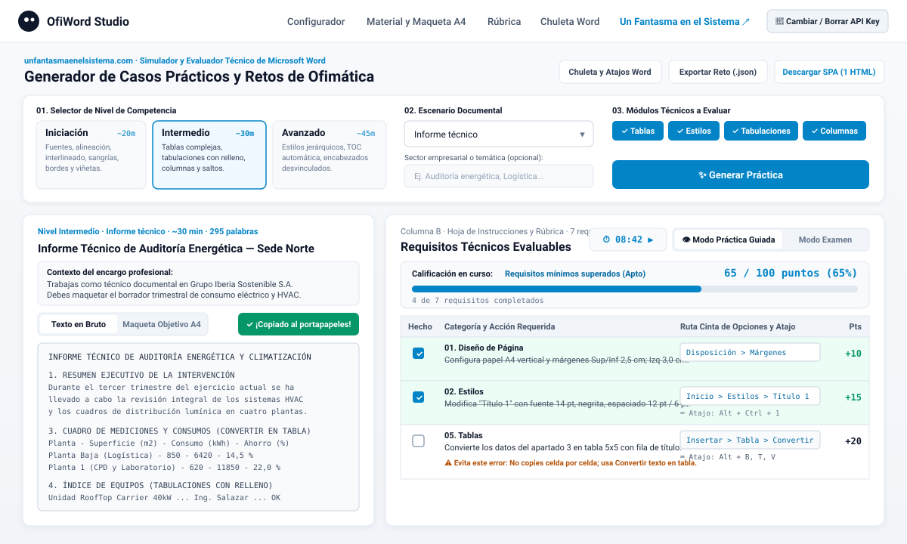
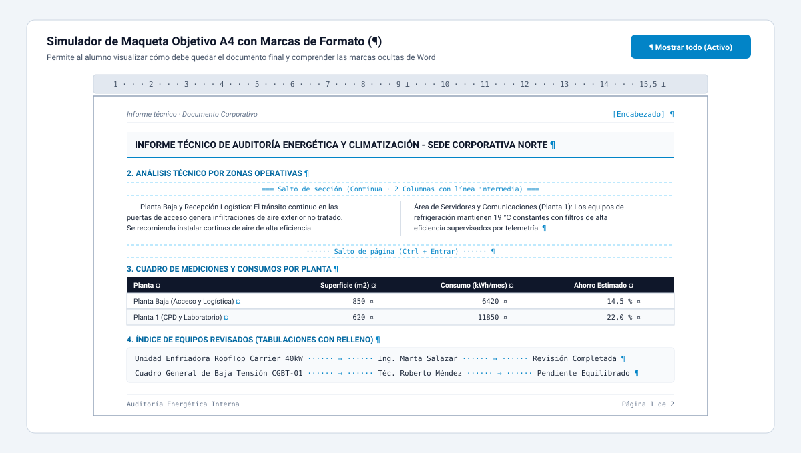
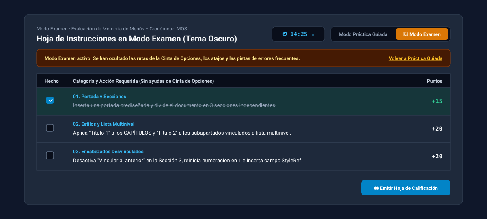
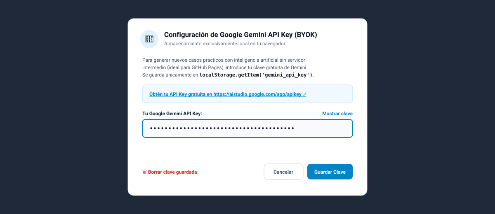

<div align="center">

<a href="https://www.unfantasmaenelsistema.com/" target="_blank" rel="noopener noreferrer">
  
</a>

# OfiWord Studio — Generador de Casos Prácticos y Retos de Microsoft Word

**Laboratorio interactivo de ofimática, simulador visual de maquetación A4 y evaluador por rúbrica impulsado por IA (Modelo BYOK 100 % Client-Side para GitHub Pages).**

[](https://www.unfantasmaenelsistema.com/)
[-059669?style=for-the-badge)](#arquitectura-byok-bring-your-own-key)
[](https://aistudio.google.com/app/apikey)
[](#despliegue-en-github-pages)

</div>

---

## Descripción General

**OfiWord Studio** es una aplicación web educativa diseñada para estudiantes y docentes de **Ofimática, Ciclos Formativos (Administración y Finanzas, Asistencia a la Dirección, Sistemas Microinformáticos) y preparación de certificaciones MOS (*Microsoft Office Specialist*)**.

Permite generar casos prácticos realistas de **Microsoft Word** (con texto continuo en bruto listo para copiar, escenario empresarial, requisitos técnicos medibles que suman 100 puntos, rutas exactas en la Cinta de Opciones, atajos de teclado y alertas de errores frecuentes) sin necesidad de servidor backend.

> **Creado por [Un Fantasma en el Sistema](https://www.unfantasmaenelsistema.com/)** — Recursos de Ofimática, Sistemas y Tecnología Educativa.

---

## Capturas de Pantalla

### 1. Panel General, Configurador Pedagógico y Área de Trabajo en 2 Columnas


### 2. Simulador de Maqueta Objetivo A4 con Botón «Mostrar todo (`¶`)»
Permite al estudiante previsualizar cómo debe quedar su documento en papel A4 (regla de márgenes y tabulaciones, columnas con línea divisoria, tablas convertidas y relleno de puntos) y activar o desactivar las marcas de formato ocultas (`¶`, `→`, `¤`, saltos de página y sección):



### 3. Modo Examen, Cronómetro MOS y Tema Oscuro
Al activar el **Modo Examen**, se ocultan automáticamente la columna de rutas en la Cinta de Opciones, los atajos de teclado y las pistas de errores frecuentes para que el alumno demuestre su dominio real de la interfaz de Microsoft Word:



### 4. Autenticación Local BYOK (*Bring Your Own Key*)
Sin claves hardcodeadas en el código fuente. Cada usuario introduce su propia API Key gratuita de Google Gemini, que se almacena exclusivamente en el `localStorage` de su navegador:



---

## Características Principales

### Para el Estudiante
- **3 Casos Oficiales Preinstalados (*Iniciación*, *Intermedio* y *Avanzado*)**: Funcionan inmediatamente al abrir la aplicación, incluso antes de configurar una clave de API.
- **Generación Ilimitada de Casos Prácticos con IA**:
  - **Niveles**: *Iniciación*, *Intermedio* y *Avanzado*.
  - **Escenarios**: *Circular interna corporativa*, *Informe técnico*, *Manual de procedimientos*, *Carta formal comercial*, *Acta de reunión ejecutiva* y *Pliego de prescripciones técnicas*.
  - **Módulos seleccionables**: *Tablas*, *Estilos*, *Tabulaciones*, *Columnas*, *Portada*, *Encabezados y Pies*, *Tabla de Contenido* y *Combinación de Correspondencia*.
- **Material de Trabajo + Simulador A4**:
  - Copia en 1 clic del texto continuo sin formato (`¡Copiado!`).
  - **Vista Previa Maqueta A4** con interruptor **Mostrar todo (`¶`)**.
  - **Autocontrol Pre-Entrega**: Lista de verificación de las 4 reglas de oro de Word antes de entregar el archivo `.docx`.
- **Rúbrica Interactiva sobre 100 Puntos**:
  - Casillas de verificación con barra de progreso en tiempo real.
  - **Modo Práctica Guiada** (muestra ruta exacta en Cinta de Opciones, atajo de teclado y error frecuente a evitar) vs **Modo Examen** (oculta todas las ayudas).
  - **Cronómetro integrado** y **Generador de Hoja de Calificación (Imprimir / Guardar PDF)**.
- **Chuleta Interactiva de Word en Español**: Modal de consulta rápida con los atajos esenciales (`Ctrl+J`, `Ctrl+M`, `Ctrl+Entrar`, `Alt+Ctrl+1`, `F9`), diferencias entre salto de página y salto de sección, y tipos de tabulación.

### Para el Docente
- **Exportar e Importar Retos (`.json`)**: El profesor puede generar un caso práctico con su clave, exportarlo en un archivo `.json` y subirlo al aula virtual (Moodle, Classroom, Teams) para que todos los alumnos carguen exactamente el mismo examen sin necesitar API Key.
- **Exportador a Único Archivo `index.html` Autocontenido**: Incluye el botón **"Descargar SPA (1 HTML)"** que empaqueta toda la aplicación (HTML5 + CSS + JS + Logo en Base64) en un único archivo ejecutable localmente con doble clic.

---

## Arquitectura BYOK (*Bring Your Own Key*)

Esta aplicación está diseñada específicamente para alojarse en servicios estáticos como **GitHub Pages**:

1. **Cero claves en el repositorio**: El código no contiene ninguna API Key.
2. **Persistencia local**: Al iniciar, comprueba `localStorage.getItem('gemini_api_key')`.
3. **Gestión transparente**: Desde el botón superior **`Cambiar / Borrar API Key`**, cualquier alumno puede actualizar su clave o eliminarla al terminar su sesión en un ordenador compartido del aula (`localStorage.removeItem('gemini_api_key')`).
4. **Llamada directa REST (`v1beta`)**:
   - Endpoint: `https://generativelanguage.googleapis.com/v1beta/models/gemini-2.5-flash:generateContent`
   - Configuración: `response_mime_type: "application/json"` con `response_schema` estricto.
   - Control de errores `400` / `403`: Notifica mediante alerta *toast* y despliega el modal de configuración.

---

## Instalación y Uso Local

```bash
# 1. Clonar el repositorio
git clone https://github.com/TU_USUARIO/ofiword-studio.git
cd ofiword-studio

# 2. Instalar dependencias
npm install

# 3. Iniciar entorno de desarrollo (puerto 3000)
npm run dev

# 4. Compilar versión estática para producción (carpeta ./dist)
npm run build
```

---

## Despliegue en GitHub Pages

El proyecto ya incluye configuración de rutas relativas (`base: './'` en `vite.config.ts`) y el flujo de trabajo automático en `.github/workflows/deploy.yml`.

### Opción A: Despliegue Automático con GitHub Actions (Recomendado)
1. Sube este repositorio a tu cuenta de GitHub (`main`).
2. En tu repositorio de GitHub, entra en **Settings > Pages**.
3. En **Build and deployment > Source**, selecciona **GitHub Actions**.
4. Cada `push` a la rama `main` compilará y publicará automáticamente la aplicación en `https://tu-usuario.github.io/nombre-repo/`.

### Opción B: Despliegue como Archivo Único (`index.html`)
1. Abre la aplicación y pulsa el botón **Descargar SPA (1 HTML)** en la barra superior.
2. Sube el archivo `index.html` descargado directamente a la raíz de cualquier repositorio o carpeta web.

---

## Autoría y Enlaces

- **Autor**: [Un Fantasma en el Sistema](https://www.unfantasmaenelsistema.com/)
- **Sitio Web**: [https://www.unfantasmaenelsistema.com/](https://www.unfantasmaenelsistema.com/)
- **Obtener Gemini API Key gratuita**: [https://aistudio.google.com/app/apikey](https://aistudio.google.com/app/apikey)
