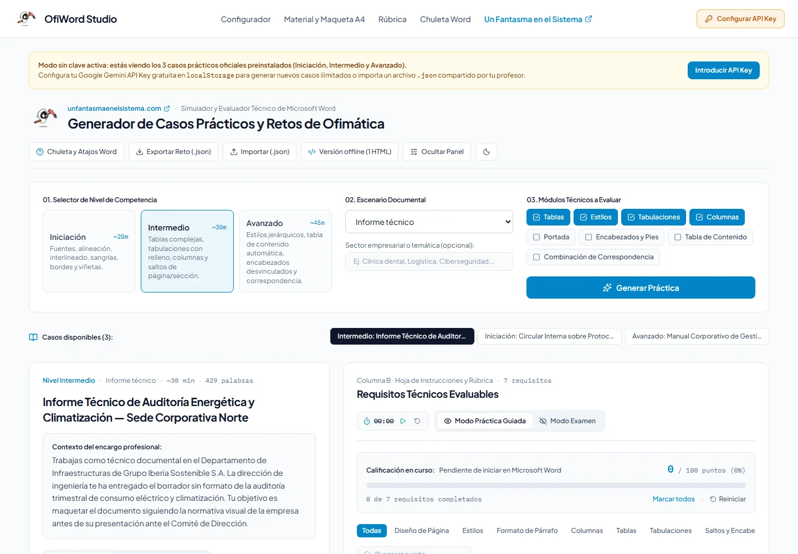
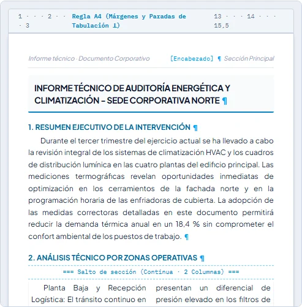
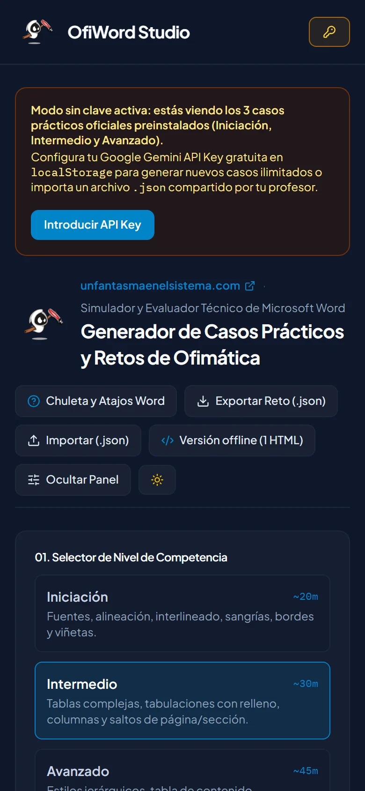
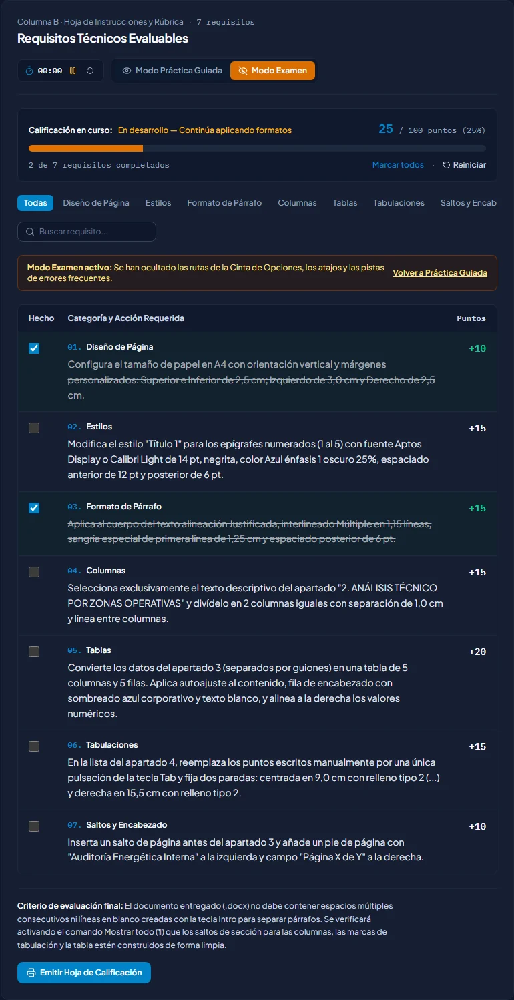
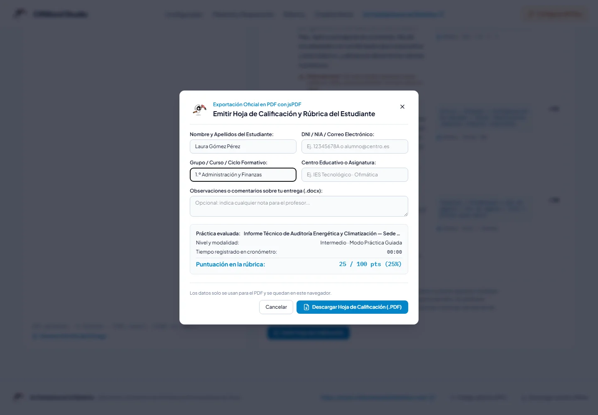

<p align="center">
  <a href="https://www.unfantasmaenelsistema.com"></a>
</p>

<h1 align="center">OfiWord Studio</h1>

<p align="center">
  <b>Casos prácticos de Microsoft Word con rúbrica, maqueta A4 y hoja de calificación</b><br>
  Para clase de ofimática · 3 casos listos sin clave · Casos nuevos con tu propia clave de Gemini
</p>

<p align="center">
  <a href="https://unfantasmaenelsistema.github.io/OfiWordStudio/"><b>▶ Abrir OfiWord Studio</b></a> ·
  <a href="#qué-hace">Qué hace</a> ·
  <a href="#para-clase">Para clase</a> ·
  <a href="#tu-clave-de-gemini">Tu clave de Gemini</a> ·
  <a href="https://www.unfantasmaenelsistema.com">unfantasmaenelsistema.com</a> ·
  <a href="LICENSE">MIT</a>
</p>

<p align="center">
  
  
  
  
</p>

<p align="center">
  
</p>

Cada caso trae un **encargo realista** (una circular, un informe técnico, un manual…), el **texto en bruto** para pegar en un Word en blanco y una **rúbrica de 100 puntos** con lo que hay que hacer, la ruta en la cinta de opciones, el atajo y el error típico. El alumno marca lo que va terminando, compara con la maqueta objetivo y emite su hoja de calificación en PDF para entregarla con el `.docx`.

> [!NOTE]
> Los casos que genera la IA son un punto de partida: revisa rutas y atajos antes de usarlos en un examen. Los 3 casos oficiales están escritos a mano.

## Qué hace

- **3 casos oficiales** (Iniciación, Intermedio y Avanzado) que funcionan nada más abrir, sin clave ni registro.
- **Casos nuevos con IA**: eliges nivel, escenario (circular, informe, manual, carta, acta, pliego), módulos (tablas, estilos, tabulaciones, columnas, portada, encabezados y pies, tabla de contenido, correspondencia) y, si quieres, el sector. Los puntos se reajustan para que sumen exactamente 100.
- **Texto en bruto y maqueta objetivo A4**: copia en un clic y una vista de cómo debería quedar (tabla convertida, tabulaciones con relleno, columnas con salto de sección) con un interruptor **Mostrar todo (¶)** como el de Word.
- **Rúbrica interactiva**: progreso en tiempo real, filtro por categoría y búsqueda. El **modo examen** oculta rutas, atajos y pistas, y arranca el cronómetro.
- **Autocontrol antes de entregar**: las 4 reglas de oro (nada de Intro vacíos, ni espacios para alinear, estilos en los títulos, saltos de sección limpios).
- **Hoja de calificación en PDF** con los datos del alumno, la rúbrica marcada, el tiempo y una casilla para la nota del docente.
- **Chuleta de Word** con los atajos esenciales en español, salto de página frente a salto de sección y tipos de tabulación.
- Tema claro y oscuro (recuerda tu elección), usable con teclado y sin desbordes en móvil.

<p align="center">
  
  
</p>

## Para clase

1. **El docente** genera un caso (o usa uno oficial) y pulsa **Exportar reto (.json)**. Lo sube a Moodle, Classroom o Teams.
2. **Cada alumno** pulsa **Importar (.json)**: todos tienen el mismo caso y **no necesitan clave**.
3. El alumno copia el texto en bruto, maqueta en Word y marca la rúbrica. Para un examen, activa **Modo examen**.
4. Al terminar, **Emitir hoja de calificación** → PDF que entrega junto al `.docx`. La nota final la pone el docente revisando el documento con **Mostrar todo (¶)**.

¿Aula sin Internet o con la web bloqueada? Pulsa **Versión offline (1 HTML)**: descarga la aplicación completa en un solo archivo (`ofiword-studio.html`, ~1,4 MB) que se abre con doble clic. Los casos oficiales y la importación funcionan sin conexión; generar con IA sí necesita Internet.

<p align="center">
  
  
</p>

## Tu clave de Gemini

Generar casos nuevos usa la API de Google Gemini con **tu propia clave** (gratuita en [Google AI Studio](https://aistudio.google.com/app/apikey)). No hay servidor intermedio:

- La clave se guarda solo en el `localStorage` de tu navegador y viaja directamente a Google en la cabecera `x-goog-api-key` (nunca en la URL). En un ordenador compartido, bórrala al terminar con **Cambiar / Borrar API Key**.
- Se usa `gemini-3.8-flash` y, si no está disponible o se agota la cuota, `gemini-3.5-flash-lite`. Los modelos 2.5 ya no se ofrecen a claves nuevas.
- Los errores se explican: clave no válida o restringida, cuota agotada (espera un minuto) o servicio saturado.
- La web publicada tiene una CSP estricta: solo puede conectarse a `generativelanguage.googleapis.com`. Las fuentes van incluidas (sin Google Fonts) y los datos del alumno para el PDF no salen del navegador.

## Usarlo en local

```bash
git clone https://github.com/unfantasmaenelsistema/OfiWordStudio.git
cd OfiWordStudio
bun install        # o npm install
npm run dev        # http://localhost:3000
npm test           # 19 pruebas del núcleo (node --test, sin navegador)
npm run build      # tipos + web en dist/ + dist/ofiword-studio.html
```

Necesitas Node.js 24 (las pruebas ejecutan TypeScript directamente) y, para instalar con el lockfile, [Bun](https://bun.sh). La lógica está en `src/lib/` sin DOM (`caso.ts` valida casos importados o generados, `gemini.ts` habla con la API, `maqueta.ts` interpreta el texto para la maqueta) y los casos oficiales en `src/data.ts`; `src/App.tsx` es la interfaz (React + Tailwind). Cada cambio en `main` se prueba y se publica en GitHub Pages con `.github/workflows/pages.yml`.

## Cambios

**v2.0 (2026-10-25)** — revisada al pasar a la organización. La v1 la generó Google AI Studio y tenía estos problemas:

- **No se podía publicar**: el workflow usaba `npm ci` con caché de npm en un proyecto con `bun.lock`, así que fallaba antes de instalar. Además arrastraba un servidor Express (`npm run dev`) que la web no usaba y que llamaba a Gemini con una clave del servidor.
- **Modelo sin acceso para alumnos nuevos**: llamaba a `gemini-2.5-flash`, que Google ya solo sirve a quien lo usaba antes. La clave iba en la URL (`?key=`).
- **Un `.json` mal formado dejaba la página en blanco** (bastaba un requisito sin texto) y nada validaba lo que devolvía la IA. A partir del 18.º caso generado empezaban a desaparecer los 3 oficiales.
- **Texto invisible**: con Windows en modo oscuro y la app en claro, varios títulos salían en blanco sobre blanco (las clases `dark:` seguían al sistema, no al interruptor). El tema no se recordaba.
- **La «SPA en 1 HTML» no era la aplicación**: descargaba otra página distinta, mucho más simple, con un fallo de inyección de HTML (un reto importado podía meter código en el archivo descargado). Ahora la build genera de verdad la aplicación completa en un archivo.
- **Detalles**: la cabecera se desbordaba en pantallas medianas (a 800 px la página medía 1138); el PDF destrozaba los nombres con tildes (`bego_a_n_ez`); la maqueta ponía «salto de página» delante de cualquier tabla, las columnas siempre en el tercer bloque y «Página 1 de 2» fijo; el `¶` de la fuente parecía un «1»; capturas del README dibujadas a mano; sin licencia (la cabecera decía Apache 2.0, de la plantilla).

## Créditos y licencia

Hecho por **[Un Fantasma en el Sistema](https://www.unfantasmaenelsistema.com/)** para las clases de ofimática. Código abierto bajo licencia [MIT](LICENSE). Usa [jsPDF](https://github.com/parallax/jsPDF), [Lucide](https://lucide.dev/) y las fuentes Plus Jakarta Sans e IBM Plex Mono (OFL) vía [Fontsource](https://fontsource.org/).

Microsoft Word es una marca de Microsoft Corporation; este proyecto no está afiliado a Microsoft ni a Google.
